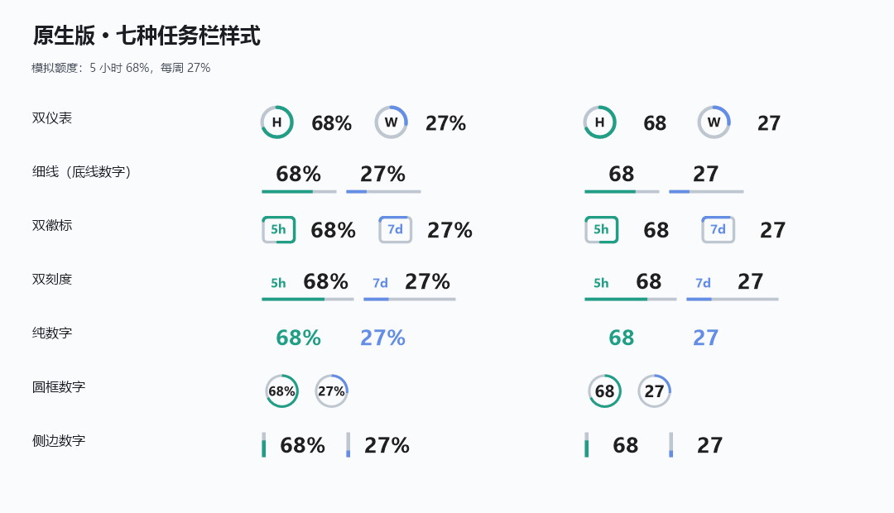
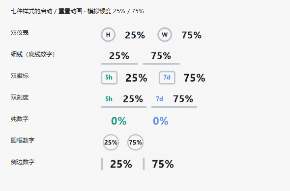
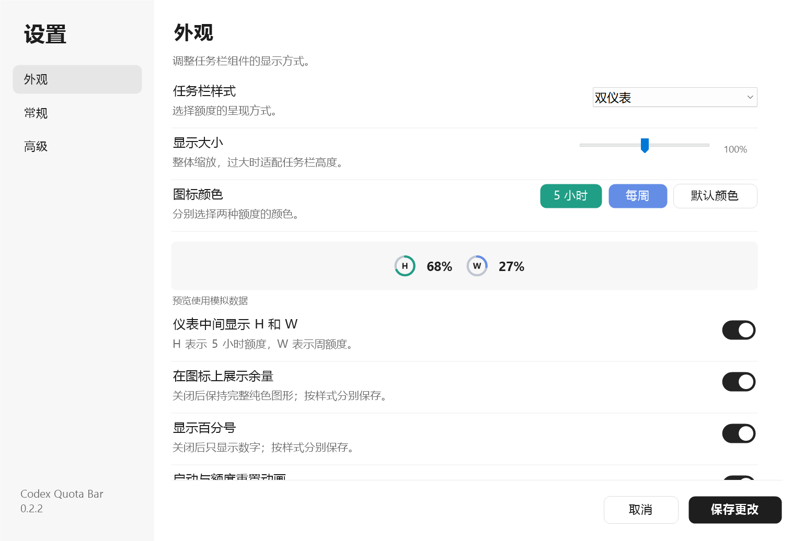
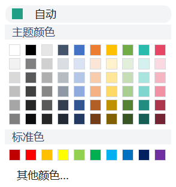
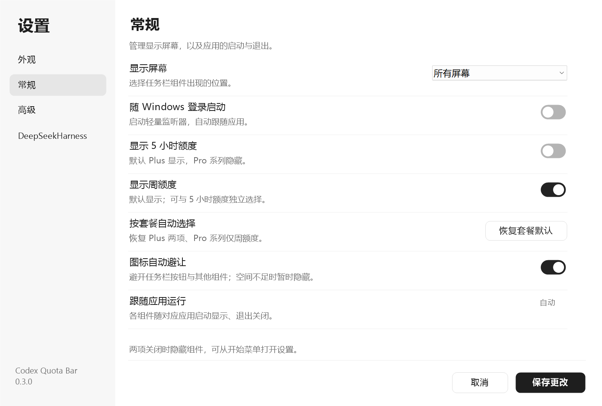
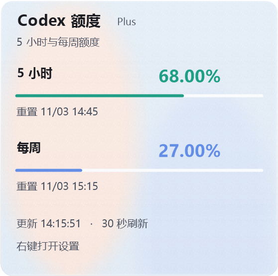
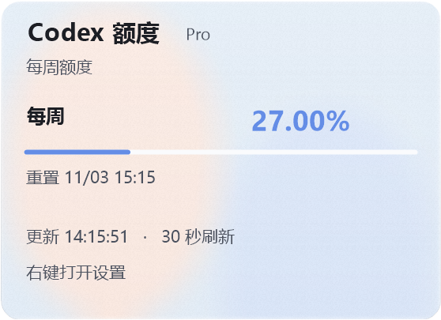
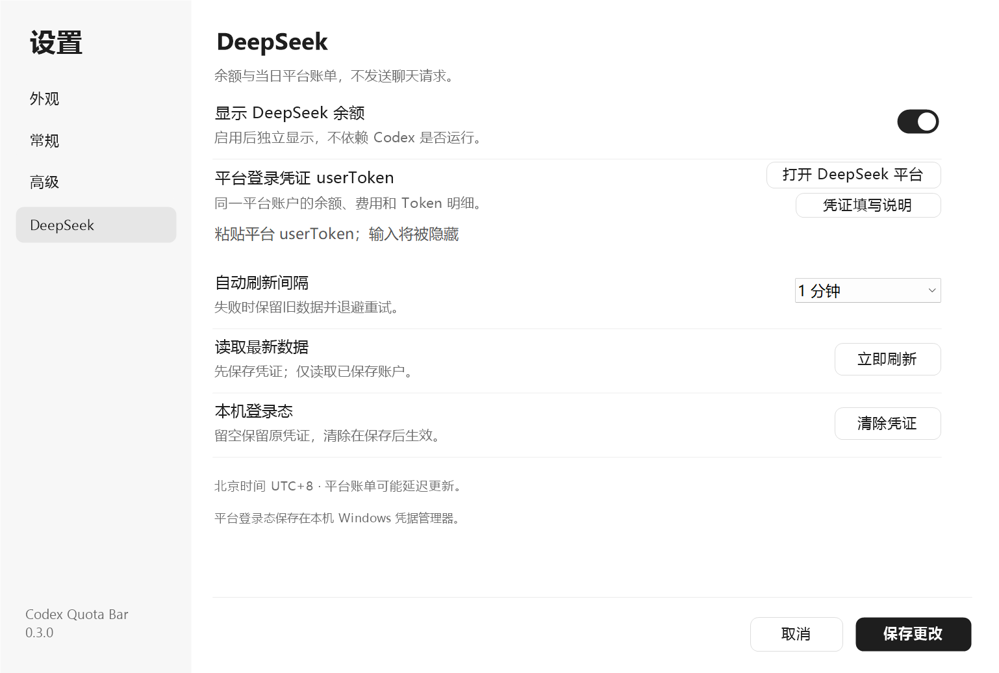
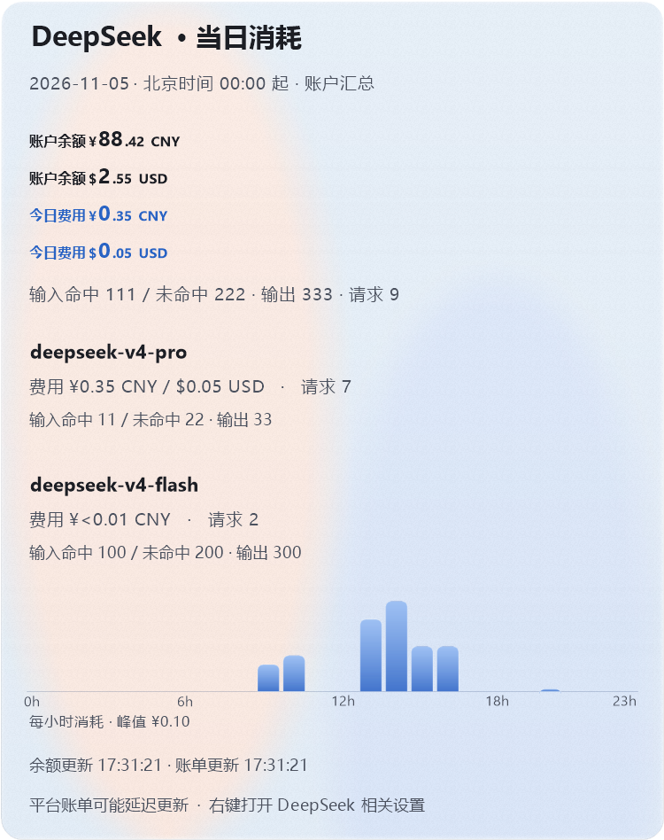

<p align="center"></p>

# Codex Quota Bar

Windows 任务栏额度与余额显示工具。支持 Codex 5 小时额度、周额度，以及 DeepSeekHarness 组件的账户余额和当日消费；鼠标悬浮查看详情，右键打开设置。

支持 Windows 10/11 x64，无需额外安装 .NET 或 C++ 运行库。这是独立工具，与 OpenAI、DeepSeek 无隶属关系。

| 版本 | 状态 | 内容 |
| --- | --- | --- |
| [0.2.2](https://github.com/SaturdayF/codex-quota-bar/releases/tag/v0.2.2) | 已发布 | Codex 额度显示、外观设置、动画、多屏支持 |
| 0.3.0 | 开发中，尚未发布 | 增加随 Harness 启停的 DeepSeekHarness 余额与消费组件 |

[下载发布包](https://github.com/SaturdayF/codex-quota-bar/releases) · [版本记录](CHANGELOG.md) · [开发说明](docs/DEVELOPMENT.md)

本文界面图中的金额、额度、Token 数量与重置时间均为模拟数据。

## Codex 额度

| 功能 | 说明 |
| --- | --- |
| 自动显示 | 任一 ChatGPT / Codex 桌面应用运行时显示；两者均退出后停止读取并隐藏 Codex 组件 |
| 额度选择 | 5 小时和周额度可分别开关；默认 Plus 显示两项，Pro 系列显示周额度 |
| 七种样式 | 双仪表、底线数字、双徽标、双刻度、纯数字、圆框数字、侧边数字 |
| 外观设置 | 颜色、60%–140% 缩放、余量图形、百分号、H/W 标记和动画 |
| 多屏显示 | 支持主屏、指定显示器或全部屏幕；支持横向拖动 |
| 悬浮详情 | 显示套餐类型、精确额度、重置时间、更新时间和读取状态 |
| 刷新间隔 | 15 秒、30 秒、1 分钟、2 分钟或 5 分钟，默认 30 秒；支持手动刷新 |
| 状态提示 | 缺失数据显示 `--`；读取失败保留最后成功值并标记状态，自动退避重试 |

### 外观与动画

图形支持按余量比例显示或完整填充，百分号和动画选项按样式保存。首次读取与额度重置时播放约 1.2 秒的动画；设置预览在切换样式或余量开关时重播。预览动画遵循样式与 Windows 动画设置。





在“外观”页修改样式、大小和颜色后，点击“保存更改”应用；取消会放弃未保存的更改。





### 额度显示与详情

在“常规”页分别开关 5 小时和周额度。“恢复套餐默认”恢复自动显示规则，设置同步影响任务栏、悬浮详情和预览。两项均关闭时隐藏 Codex 组件，设置快捷方式仍可使用。

0.3.0 开发版新增“图标自动避让”，默认开启。组件避开可识别的任务栏按钮和通知区域，联合查找整条任务栏的空位；必要时移动另一组件，让两个组件分别放入合适的空位。总空间不足时暂时隐藏放不下的组件，空位恢复后显示。关闭后可手动摆放。

按住鼠标左键拖动组件，可跨过任务栏图标移动到另一端，拖动预览可覆盖其他组件。松手时重叠面积达到较小组件面积的 50% 则交换位置，低于 50% 则回原位；没有重叠时在落点附近寻找空位。最终位置避开任务栏图标并保持组件间距。布局在本次运行中的设置变更和任务栏重建后保留，重新启动恢复默认位置。

松手后的吸附、回位和交换使用约 240 毫秒的减速移动过渡。再次拖动可从当前显示位置立即接管；Windows 关闭动画效果时直接落位。



悬浮详情显示当前套餐及所选额度。手动开启但账户未返回的额度显示 `--`。

 

## DeepSeekHarness（0.3.0 开发版）

任务栏显示账户余额和当日消费。悬浮详情按模型展示费用、请求数、缓存命中输入、缓存未命中输入及输出 Token；模型较多时可滚轮翻阅。

组件默认待机：检测到 DeepSeek Harness 桌面应用运行后显示并开始查询，应用退出后隐藏、取消本轮查询并清空显示数据。是否运行 Codex 不影响该组件。设置中的“自动跟随 DeepSeekHarness”可关闭自动联动。检测依据桌面进程，最小化或留在托盘时仍视为运行；不识别仅在浏览器或命令行运行的 Harness。

“未启动时也显示余额”默认关闭。开启并保存后，无需运行 Harness 即可显示和刷新余额、当日消费及明细；Harness 退出不会隐藏组件。该选项与自动跟随独立，两个开关均关闭时停止显示和查询。

组件显示期间默认每分钟刷新，可选 2 分钟或 5 分钟，支持手动刷新；两个显示条件均不满足时，手动刷新也不发起查询。

### 凭证与配置

DeepSeek 功能使用平台登录态 `userToken`，读取账户余额、当日消费和 Token 明细。程序不读取或保存 DeepSeek API Key，也不收集账号密码。`userToken` 属于登录凭证，保存在本机 Windows 凭据管理器。

1. 打开“设置 → DeepSeekHarness”，点击“打开 DeepSeek 平台”并在浏览器中登录。
2. 按 F12，在 **Application / 应用 → Local Storage / 本地存储 → `https://platform.deepseek.com`** 中找到 `userToken`。
3. 将令牌或含 `value` 的 JSON 值填入“平台登录凭证”，保留“自动跟随 DeepSeekHarness”开启，点击“保存更改”。设置中的“凭证填写说明”提供相同步骤。

凭证输入框留空表示保留已有值；“清除凭证”在保存后生效。余额与消费均来自登录态对应的平台账户。

### 统计范围与数据状态

- “当日”按北京时间 UTC+8 零点切分，覆盖整个平台账户的用量。
- 消费金额来自平台账单，按模型聚合；不同币种分别显示。
- 详情显示余额和账单的更新时间，读取失败时显示状态提示；平台数据可能存在更新延迟。
- 余额、费用和 Token 明细来自 [DeepSeek 平台](https://platform.deepseek.com/usage)的私有接口，接口变化、登录态失效或访问失败时显示错误状态。
- 已完成一次真实账户的余额、费用和 Token 接口只读验证；文档截图及自动化回归使用模拟数据。


 

## 安装与使用

当前发布包为 **0.2.2**，包含 Codex 功能。DeepSeek 功能位于 0.3.0 开发代码中。

- [EXE 安装包](https://github.com/SaturdayF/codex-quota-bar/releases/download/v0.2.2/CodexQuotaBar-v0.2.2-Setup.exe)：安装时可选择路径和登录启动。
- [Portable ZIP](https://github.com/SaturdayF/codex-quota-bar/releases/download/v0.2.2/CodexQuotaBar-v0.2.2-Portable-win-x64.zip)：解压后运行 `CodexQuotaBar.exe`。

安装版默认目录为 `%LOCALAPPDATA%\Programs\CodexQuotaBar\0.2.2`，也可选择其他当前用户可写的专用目录。

Codex 额度读取需要本机 Codex CLI 已通过 ChatGPT 账户登录。自动识别失败时，可在“高级”页指定 `codex.exe`。显示的数据属于 **CLI 当前登录账户**，可能与桌面应用登录的账户不同。

右键组件打开设置，也可从开始菜单打开 **Codex Quota Bar Settings**，或运行 `CodexQuotaBar.exe --settings`。左键横向拖动组件；悬浮查看详情。关闭或最小化 ChatGPT / Codex 窗口不等于退出其进程。

## 退出与卸载

- “高级 → 退出额度工具”结束程序及后台监听。
- 安装版可通过“高级 → 卸载程序”或 Windows 应用列表卸载。卸载器按安装记录删除程序文件，保留目录中的无关文件。
- 便携版退出后可删除解压目录。
- 0.3.0 安装版在卸载时选择删除设置，会同时删除 DeepSeek 凭证；便携版可在删除目录前通过设置清除凭证。

本工具的卸载操作不影响 ChatGPT / Codex 的安装和登录数据。

## 数据与隐私

Codex 数据通过本地 `codex app-server` 读取，认证由 CLI 处理。DeepSeek 数据通过 HTTPS 从其余额或平台账单接口读取。

设置文件位于 `%LOCALAPPDATA%\CodexQuotaBar`。DeepSeek 凭证保存在当前 Windows 用户的凭据管理器，不写入设置 JSON、命令行或日志。程序不保存账户密码，不创建聊天或发起模型推理，无额外遥测后端。

## 限制

- 主要适配标准水平任务栏；自动隐藏、竖直任务栏、替代任务栏及全屏场景尚未完成专项验证。
- 窗口验证覆盖本机已连接屏幕，其他设备、DPI 和 Windows 版本可能存在差异。
- 拖动位置不跨重启保存；显示器断开时回退主屏。
- Pro 系列默认仅显示周额度属于本工具的显示行为，不代表服务端一定不提供 5 小时窗口。
- Codex API-key-only 账户不支持此处的订阅额度读取。
- 上游协议、平台账单接口或凭证有效期变化可能影响读取结果。
- 程序尚未代码签名，未提供自动更新。

## 项目结构

```text
native/          C++ 程序、设置、绘图、数据读取与检查
native/vendor/   JSON 头文件及许可证
tests/           安装与卸载检查
assets/          应用图标
docs/            界面预览、开发说明与版本记录
scripts/         构建、打包和发布脚本
installer/       EXE 安装器配置
artifacts/       本地构建产物，不提交到仓库
```

构建与验证步骤见 [开发说明](docs/DEVELOPMENT.md)。许可证：[MIT](LICENSE)。
