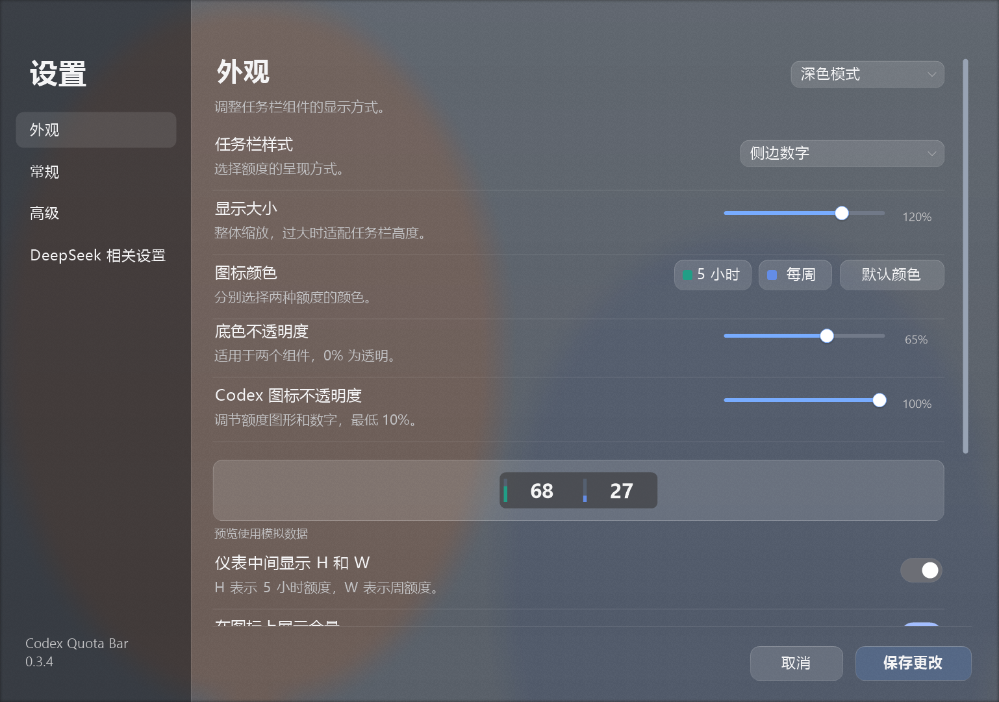
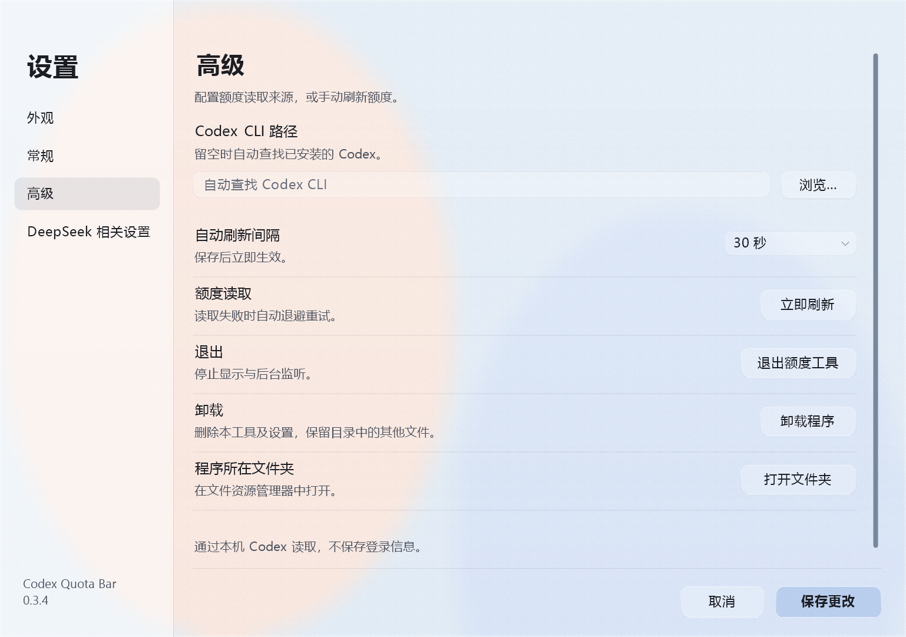
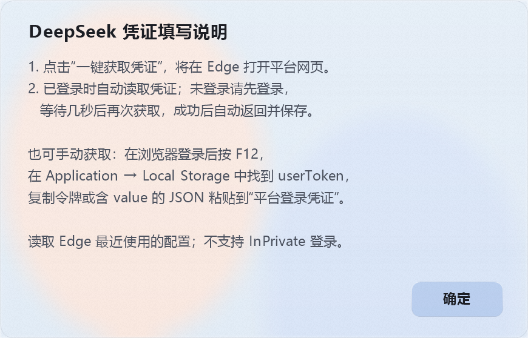

# Codex Quota Bar

在 Windows 任务栏显示 Codex 额度和 DeepSeek 账户余额，支持多屏、拖动布局、悬浮详情和自动刷新。

**最新发布：[0.3.8](https://github.com/SaturdayF/codex-quota-bar/releases/tag/v0.3.8)** · Windows 10/11 x64 · C++ 原生程序

**稳定版：[0.3.8](https://github.com/SaturdayF/codex-quota-bar/releases/tag/v0.3.8)**

[安装包](https://github.com/SaturdayF/codex-quota-bar/releases/download/v0.3.8/CodexQuotaBar-v0.3.8-Setup.exe) · [便携包](https://github.com/SaturdayF/codex-quota-bar/releases/download/v0.3.8/CodexQuotaBar-v0.3.8-Portable-win-x64.zip) · [SHA-256 校验](https://github.com/SaturdayF/codex-quota-bar/releases/download/v0.3.8/SHA256SUMS.txt) · [版本记录](CHANGELOG.md)

## 界面预览

设置默认浅色，可切换深色。设置、顶栏和悬浮详情使用系统实时毛玻璃，背景随窗口移动和后方内容变化更新。下拉列表、按钮与输入框采用圆角样式，右侧使用细长滚动条。

深色、常规与高级设置

### Codex 额度

七种任务栏样式，支持独立配色、余量图形和百分号。悬浮可查看套餐、剩余额度与重置时间。

### DeepSeek 余额与用量

显示账户余额和北京时间当日消费，悬浮查看模型费用、请求数及 Token 明细。组件可随 Harness 启停，也可独立常驻；DSH 标识可单独隐藏，组件宽度随内容缩短。

以上预览中的额度、余额、用量和背景均为模拟数据。运行时的毛玻璃背景由系统实时合成，实际效果随桌面内容与系统设置变化；省电模式下毛玻璃不可用。

## 功能

| 功能 | 说明 |
| --- | --- |
| Codex 额度 | 5 小时和周额度可分别开关；套餐默认值为 Plus 两项、Pro 系列仅周额度 |
| DeepSeek | 账户余额、当日消费及按模型汇总的费用、请求数、缓存输入和输出 Token；详情含当日每小时消耗柱状图；支持隐藏 DSH 标识 |
| 自动跟随 | Codex 组件随 ChatGPT / Codex 桌面进程显示；DeepSeek 可随 Harness 桌面进程显示，也可独立常驻 |
| 多屏与布局 | 主屏、指定屏幕或全部屏幕；自动避让任务栏图标，支持跨越图标拖动、相邻落位和交换 |
| 外观 | 浅色/深色设置、七种额度样式、独立配色、60%–140% 缩放、百分号、余量图形及 H/W 标记 |
| 透明度 | 两个组件共用 0%–100% 底色不透明度；Codex 图形与数字另有 10%–100% 不透明度 |
| 动画 | 启动与额度重置动画、设置内动画预览，以及拖动释放后的平滑移动 |
| 托盘与详情 | 运行时显示托盘图标，点击打开设置，右键打开设置或退出；组件悬浮显示详情 |
| 刷新 | Codex 可选 15 秒至 5 分钟，DeepSeek 可选 1 / 2 / 5 分钟；支持手动刷新和失败退避 |
| 安装与卸载 | 自定义安装目录、可选桌面设置快捷方式；设置内打开程序目录；安装版和便携版均提供卸载入口 |

## 开始使用

1. 运行安装包选择安装目录，或完整解压便携包后运行 `CodexQuotaBar.exe`。无需额外安装 .NET 或 C++ 运行库。安装时可选添加桌面快捷方式。
2. 使用 Codex 额度前，在本机 Codex CLI 中通过 ChatGPT 账户登录。自动识别失败时，在“高级”页指定 `codex.exe`。
3. 使用 DeepSeek 时，在“DeepSeek 相关设置”页点击“一键获取凭证”，程序会按 Windows 默认浏览器设置打开平台网页（支持 Edge 和 Chrome），并读取最近使用配置中的 `userToken`，验证有效后自动返回 DeepSeek 设置页并保存凭证。未登录时请在网页中登录，等待几秒后再次获取。成功后显示确认弹窗；失败提示会提醒检查网页版登录状态。提示弹窗随文字长度调整大小。无需安装浏览器扩展，也可按“凭证填写说明”手动填写并点击“保存更改”；无需填写 API Key。
4. 点击托盘图标或右键任务栏组件打开设置。托盘图标可能收纳在 Windows 的上箭头菜单中。设置完成后点击“保存更改”。

额度属于 Codex CLI 当前登录账户。关闭应用窗口或最小化不等于退出进程；后台监听器会等待应用再次启动。

## 设置与操作

| 栏目 | 设置内容 |
| --- | --- |
| 外观 | 浅色/深色模式、任务栏样式、显示大小、额度配色、底色与 Codex 图标透明度、文字标记和动画 |
| 常规 | 显示屏幕、登录启动、5 小时/周额度开关、恢复套餐默认、图标自动避让 |
| 高级 | Codex CLI 路径、刷新间隔、立即刷新、退出、卸载和打开所在文件夹 |
| DeepSeek 相关设置 | 自动跟随 Harness、未启动时显示余额、显示 DSH 图标、从 Edge / Chrome 一键获取或手动粘贴平台凭证、刷新与清除凭证 |

- **拖动布局**：按住左键横向拖动，可越过任务栏原有图标。重叠达到另一组件面积的 50% 时，对方提前让位；松手确认交换，两个组件相邻摆放。重叠不足时松手贴靠，空间不足时寻找其他空位；无可用空间时暂时隐藏。位置在本次运行中保留。
- **详情**：悬浮查看额度或账单；DeepSeek 模型较多时可用滚轮翻阅。
- **DSH 图标**：默认显示。关闭仅隐藏标识，保留余额、当日消费和悬浮详情，组件自动缩短。
- **DeepSeek 显示**：默认随 Harness 显示；“未启动时也显示余额”可独立开启。两个显示开关均关闭时停止显示和查询。
- **凭证**：`userToken` 保存在 Windows 凭据管理器。一键获取成功后立即保存并刷新查询；其他设置仍需点击“保存更改”。输入留空保留已有值，“清除凭证”在保存后生效。
- **自动获取范围**：支持默认 Edge / Chrome 标准用户数据目录中的 LevelDB 本地存储；不支持 InPrivate、自定义用户数据目录或已迁移为 SQLite 的存储格式。读取受限时可手动填写，不会修改浏览器数据。获取时的网络失败会单独提示。
- **退出与卸载**：“高级”页提供对应入口。卸载保留程序目录中的无关文件；便携版卸载需要系统 PowerShell。

完整操作说明见 [使用指南](native/USER_GUIDE.md)。

## 数据与适用范围

Codex 额度通过本地 `codex app-server` 读取；DeepSeek 余额和用量通过平台接口读取，当日统计按 UTC+8 切分，不同币种分别显示。设置保存在 `%LOCALAPPDATA%\CodexQuotaBar`，DeepSeek 凭证单独存入 Windows 凭据管理器。

主要适配 Windows 标准水平任务栏。自动隐藏、竖直和第三方任务栏尚未专项验证；上游接口、凭证有效期和系统安全策略可能影响读取或卸载。数据可能存在更新延迟。程序尚未代码签名。

Windows 11 22H2 及以上使用 Desktop Acrylic，较早系统使用兼容模糊；系统合成不可用、启用高对比度或进入省电模式（Battery Saver）时回退为纯色。省电模式下系统会关闭半透明与模糊，因此毛玻璃效果不可用，设置与详情恢复为不透明底色。Windows 10 兼容材质尚未完成实机专项验证。

这是独立工具，与 OpenAI、DeepSeek 无隶属关系。

## 开发

0.3.8 已通过 479 项核心检查与 59 项 DeepSeek UI 检查。发布包附带 SHA-256 校验文件，已发布标签和附件保持固定。

[构建与测试](docs/DEVELOPMENT.md) · [安装器](installer/README.md) · [MIT 许可证](LICENSE)
