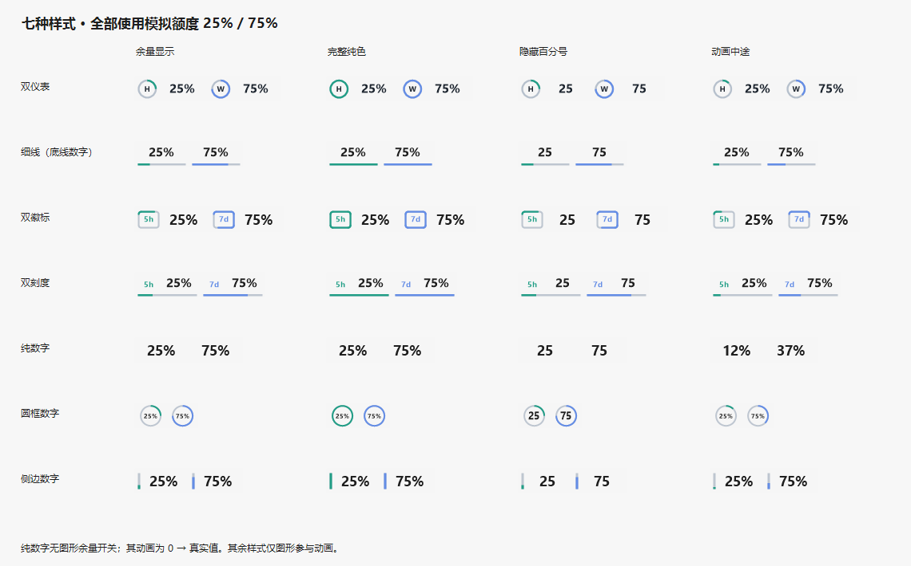
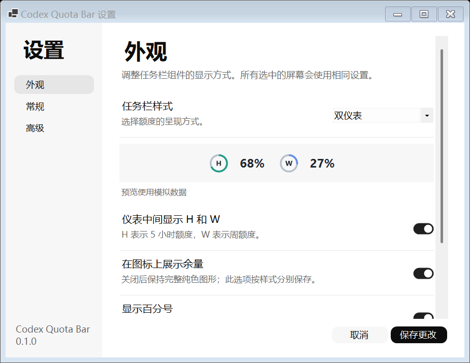
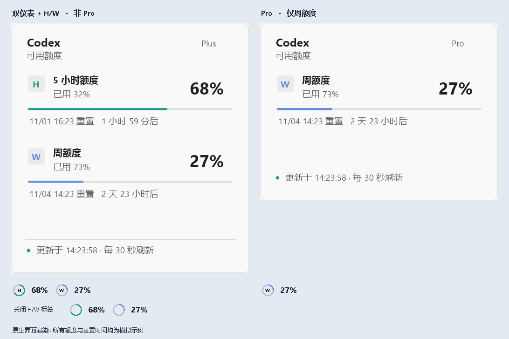

<p align="center"></p>

# Codex Quota Bar

把 Codex 的 **5 小时额度、周额度**放到 Windows 任务栏上。打开 ChatGPT 或 Codex 桌面应用时自动出现，鼠标悬停查看详情，右键调整外观和行为。

**当前版本：v0.1.0** · [下载发布包](https://github.com/SaturdayF/codex-quota-bar/releases) · [版本记录](CHANGELOG.md) · [开发说明](docs/DEVELOPMENT.md)

这是独立的 Windows 伴随工具，与 OpenAI 无隶属关系。下文插图均由本工具的界面或渲染代码生成，**额度和重置时间为模拟数据**。

## 已实现的功能

| 功能       | 当前行为                                                                                                        |
| ---------- | --------------------------------------------------------------------------------------------------------------- |
| 自动跟随   | 任一 ChatGPT / Codex 桌面进程运行时显示，两者都完全退出后收起并停止读取；后台轻量监听器继续等待下次启动。       |
| 多屏显示   | 可选主屏、指定显示器或全部屏幕；透明组件贴在各屏任务栏上，按实际高度居中，支持横向拖动。                        |
| 七种样式   | 双仪表、底线数字、双徽标、双刻度、纯数字、圆框数字、侧边数字，设置页即时预览。                                  |
| 独立颜色   | 分别修改两种额度的颜色；提供主题色、深浅色阶、标准色、自定义颜色和恢复默认。                                    |
| 显示大小   | 整体缩放 60%–140%；过大时按任务栏高度等比例适配。                                                              |
| 余量与文字 | 各样式独立设置百分号、动画；除纯数字外可选择图形是否展示余量；双仪表可开关 H/W。                                |
| 填充动画   | 首次成功读取、确认额度重置时播放；切换样式时重新演示。纯数字由 0 递增到真实值，其他样式填充圆环、边框或进度线。 |
| 悬浮详情   | 进入组件即显示半透明圆角底色，停留后显示精确额度、重置时间、更新时间和读取状态。                                |
| 可调刷新   | 15 秒、30 秒、1 分钟、2 分钟、5 分钟，默认 30 秒；支持立即刷新，保存新间隔无需重启。                            |
| 状态提示   | 缺失额度显示 `--`；读取失败保留最后成功值并标记过期，自动退避重试。                                           |
| 账户规则   | 识别为 Pro 时按本工具的显示偏好仅展示周额度；未知套餐保留两种额度。                                             |
| 设置与维护 | 右键打开设置、随系统深浅主题、登录启动开关、退出工具，以及安装版的一键卸载。                                    |

### 七种外观

此外提供可直接运行、可修改安装路径的离线 EXE 安装器，以及适用于已有运行时电脑的小 Portable ZIP。

图形可以按真实剩余比例显示，也可以保持完整纯色；百分号与动画按样式分别保存。



### 余量动画

动画时长约 1.2 秒。普通轮询不会反复播放；系统关闭客户端动画时不会自动播放。下图为循环演示，真实程序只在触发条件成立时播放一次。


### 外观设置与颜色

选择样式、大小和颜色后先看预览，点击“保存更改”应用；取消会放弃未保存的更改。




### 悬浮详情

常态保持透明；悬浮时出现 Windows 任务栏按钮式底色，并展开详细额度卡。鼠标可移入卡片继续查看。



## 安装与使用

1. 下载 [CodexQuotaBar-v0.1.0-Setup.exe](https://github.com/SaturdayF/codex-quota-bar/releases/download/v0.1.0/CodexQuotaBar-v0.1.0-Setup.exe)，双击运行。
2. 在“选择目标位置”页输入路径或点击“浏览”，选择本工具专用文件夹；可选择登录启动和安装完成后启动。
3. 打开 ChatGPT 或 Codex 桌面应用，组件会自动显示。右键组件打开设置；也可从开始菜单打开 **Codex Quota Bar Settings**。

默认安装到当前用户的 `%LOCALAPPDATA%\Programs\CodexQuotaBar\0.1.0`，也可选择其他磁盘上的目录；目录需当前用户可写。安装 EXE 附带运行时，安装时不联网下载依赖，无需自行安装 .NET。

已有 **.NET 10 Desktop Runtime x64** 的用户可下载 [小体积 Portable ZIP](https://github.com/SaturdayF/codex-quota-bar/releases/download/v0.1.0/CodexQuotaBar-v0.1.0-Portable-win-x64.zip)，解压后运行 `CodexQuotaBar.exe`。此 ZIP **不包含运行时**，不能在未安装该依赖的电脑直接运行。普通用户建议选择 EXE。

需要本机 **Codex CLI 已通过 ChatGPT 账户登录**；也可使用桌面应用附带的 CLI。自动识别失败时，在“高级”页指定 `codex.exe`。数据来自 **Codex CLI 的登录账户**：如果 ChatGPT 与 Codex 登录不同账户，看到的额度可能不同。

关闭窗口、最小化或关闭到托盘均不等于退出应用进程。日常使用无需额外点击本工具的图标。

## 退出与卸载

“高级 → 退出额度工具”只结束运行。安装版可点击 **“高级 → 卸载程序”**，确认后退出并移除本版本的程序、登录启动项、设置快捷方式和本工具设置。不会卸载 ChatGPT / Codex，也不会删除它们的登录数据。

EXE 安装版还可从 Windows“已安装的应用”卸载。卸载器按安装记录删除自定义目录中的程序文件，不递归删除用户额外放入的无关文件。

早期使用 PowerShell 安装的版本，仍可以运行原安装目录中的脚本：

```powershell
# 卸载程序，保留本工具设置
powershell.exe -NoProfile -ExecutionPolicy Bypass -File .\uninstall.ps1
# 同时删除本工具设置
powershell.exe -NoProfile -ExecutionPolicy Bypass -File .\uninstall.ps1 -RemoveSettings
```

便携版的一键卸载按钮不可用：退出后删除解压目录即可。若曾运行安装脚本，应通过安装版入口卸载。

## 读取方式与隐私

通过本地 `codex app-server` 的 JSON-RPC 调用 `account/read` 与 `account/rateLimits/read`，识别通用 Codex 额度及 300 / 10080 分钟窗口。按所选间隔读取，收到更新事件时立即展示；服务端和其他客户端的额度变化仍可能存在延迟，不保证秒级同步。

本工具不解析或保存 `auth.json`，不抓取 Cookie，不创建聊天、不发起模型推理，无额外遥测后端。Codex CLI 自行完成认证及服务端通信。设置文件只保存外观、显示器、刷新间隔和可选 CLI 路径等本工具配置，位于 `%LOCALAPPDATA%\CodexQuotaBar`。

## 边界与限制

- 任务栏组件是透明自绘窗口，并非 Windows 原生托盘图标；当前主要适配标准水平任务栏。自动隐藏、竖直任务栏、替代任务栏及全屏场景未完成专项验证。
- 窗口与色板已在本机两块不同 DPI 的屏幕上验证；其他设备和 Windows 版本仍可能存在差异。
- 拖动位置不跨重启保存。屏幕断开时回退主屏，重接后按原选择恢复；显示器以 Windows `DeviceName` 标识。
- Pro 仅显示周额度是本工具的显示规则，不代表服务端一定不提供 5 小时窗口。不支持 API-key-only 账户的订阅额度。
- 依赖当前 Codex app-server 协议与桌面进程识别方式；上游变更可能需要适配。
- 程序尚未代码签名，无自动下载或执行更新的机制。

## 版本与项目结构

原始 `v0.1.0` 源码标签保留。按用户要求，可选路径的安装 EXE 与小 ZIP 也归入同一 `0.1.0` Release，替换原大 ZIP 下载；安装器补充代码由 `v0.1.0-installer.1` 标签标识。后续其他功能修改进入 `0.2.0`。

```text
src/             运行代码、设置界面和渲染
tests/           状态、图形、交互与卸载检查
assets/          应用图标及可编辑的矢量源文件
docs/            实现插图、开发说明和发布记录
scripts/         安装、卸载、打包及文档素材生成
installer/       可选目录的原生 EXE 安装器配置
version.props    版本号来源
artifacts/       本地发布包（不提交）
```

构建、验证和发布步骤见 [开发说明](docs/DEVELOPMENT.md)。代码使用 [MIT License](LICENSE)。
